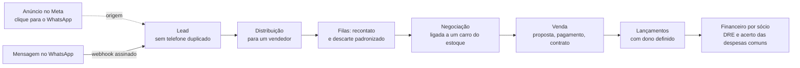

# RodoviariaOS

**Sistema de gestão para revendas de carros seminovos (SaaS multi-tenant).**
Acompanha a operação inteira: do cliente que chega pelo WhatsApp até o dinheiro no caixa de cada sócio.

Nasceu na revenda da minha família. Eu trabalhava no atendimento e nos anúncios e via todo dia cliente se perdendo no WhatsApp, financeiro em planilha e sócio fazendo acerto à mão no fim do mês. Hoje o sistema roda na loja.

> 🔒 Este é um repositório de **vitrine**. O código-fonte é fechado, porque o projeto vai virar produto. Aqui estão o problema, as funcionalidades, a arquitetura e as decisões técnicas.

**Status:** em produção numa revenda real, com dois sócios, usando dados reais da operação.

---

## O problema

Revendas pequenas e médias costumam operar com o WhatsApp no celular de cada vendedor, planilha no financeiro e um sistema de estoque engessado. Na prática:

- o lead se perde no WhatsApp, e ninguém sabe de onde ele veio nem se virou venda;
- quando a loja tem mais de um sócio, cada um tem carros e caixa próprios, mas eles dividem as despesas da loja, e o acerto entre eles é feito à mão;
- o retorno do financiamento (a comissão paga pelo banco), os impostos e os repasses são calculados em planilha;
- quem paga anúncio não sabe qual anúncio vendeu qual carro.

## Fluxo principal

## Funcionalidades

### ✅ Em produção

- **CRM ligado ao WhatsApp.** A mensagem chega por webhook assinado e vira lead sem duplicar o telefone. O lead é distribuído para um vendedor e entra em filas do que fazer agora, com recontato e motivos de descarte padronizados. A conversa atualiza na tela em tempo real.
- **Origem do lead.** O lead que vem de um anúncio do Meta (clique para o WhatsApp) fica ligado à campanha e ao carro. Um relatório mostra o caminho da origem até a negociação e a venda.
- **Estoque como dossiê do carro.** Cada carro guarda custo, despesas, preparação, documentos, interessados, negociação e resultado. Tem consulta FIPE e por placa, e avisa quando um carro que entra combina com o interesse de um cliente.
- **Vendas.** Proposta, composição do pagamento (sinal, financiamento, troca), contrato e liquidação automática quando o último recebível é baixado. Também cobre distrato sem apagar histórico, pós-venda e garantia.
- **Financeiro por sócio.** Contas, lançamentos previstos e realizados, DRE e acerto automático das despesas comuns entre os sócios. Importa extratos em OFX, CSV, XLSX e PDF (com leitor próprio por banco), sugere a categoria e aprende regras automáticas. Calcula o retorno do financiamento por faixa e apura impostos, com exportação.
- **Visão por sócio.** Cada sócio vê os próprios carros e resultados. O estoque do outro aparece como catálogo.
- **Perfis de acesso.** Dono, vendedor, marketing, fiscal/contabilidade e administrador, cada um vendo só o que precisa. O vendedor nunca vê custo nem margem.
- **Agente de IA no WhatsApp para a equipe.** Responde sobre estoque, leads e números, com as permissões de quem pergunta. Ação que grava algo só é executada depois de confirmação humana. Manda resumo diário (opcional) e respeita um teto mensal de gasto com IA. Funciona com Anthropic ou OpenAI, com chave por loja. O sistema funciona inteiro sem IA.
- **Radar de compra (fase 1).** Buscas salvas num portal de classificados, nota de oportunidade e análise, feita por IA, dos defeitos conhecidos do modelo, para ajudar a decidir o que comprar.
- **Migração.** Estoque e clientes importados do sistema que a loja usava antes.

### ⏸️ Pronto, mas desligado até a loja conectar as contas

- **Marketing.** Cria o anúncio no Meta a partir do carro e pausa o anúncio quando o carro é vendido ou reservado. Gastar dinheiro sempre pede confirmação e respeita um teto de verba. Também guarda as mídias de cada carro no Google Drive, publica no Instagram, Facebook, TikTok, YouTube e Google Meu Negócio, e usa IA para legendas e transcrição de vídeo. Cada loja conecta as próprias contas por login (OAuth), com o token guardado cifrado.

### 🚧 Em andamento

- Simulação de financiamento automatizada nos portais dos bancos (Playwright), em rodadas de teste. Login e CAPTCHA continuam com uma pessoa.
- Site público da loja ligado ao estoque. A primeira fase está no ar, e publicar os carros depende das fotos.
- Publicação automática em portais de classificados.

## Stack

| Camada | Tecnologia |
|---|---|
| Frontend | Next.js 15 (App Router), React 19, TypeScript, Tailwind CSS 4 |
| API | Fastify 5, TypeScript, Zod |
| Banco | PostgreSQL, Drizzle ORM, Row Level Security |
| Autenticação | JWT de 15 min com refresh rotativo, cookies httpOnly, Argon2 |
| WhatsApp | WAHA, com webhooks assinados (HMAC-SHA256) |
| Tempo real | Server-Sent Events |
| IA | Anthropic Claude ou OpenAI, com chave e orçamento por loja |
| Automação de navegador | Playwright |
| Testes | Vitest contra banco real, com suítes de ponta a ponta de isolamento |

## Decisões técnicas

- **Isolamento que falha fechado.** A separação entre lojas e entre sócios é feita no próprio PostgreSQL (Row Level Security), e não só na tela. Toda consulta roda com o contexto da loja e do usuário, e sem contexto ela falha. Um teste quebra se alguém criar uma tabela sem política de isolamento.
- **Dinheiro só como lançamento.** Venda, despesa, comissão e distrato viram lançamentos com dono definido. O distrato cria lançamentos novos em vez de editar a venda.
- **Histórico imutável.** Mudar uma taxa nunca altera uma operação antiga.
- **IA com freio.** O agente propõe, a pessoa confirma e só então ele executa, com auditoria. Gastar com anúncio também exige confirmação e teto.
- **Deploy por etapas.** Cada deploy tem roteiro, backup antes e conferência automática antes de seguir.

## Contato

Vitor Brosque · [LinkedIn](https://www.linkedin.com/in/vitorbrosque) · [GitHub](https://github.com/Vitor-Brosque)
