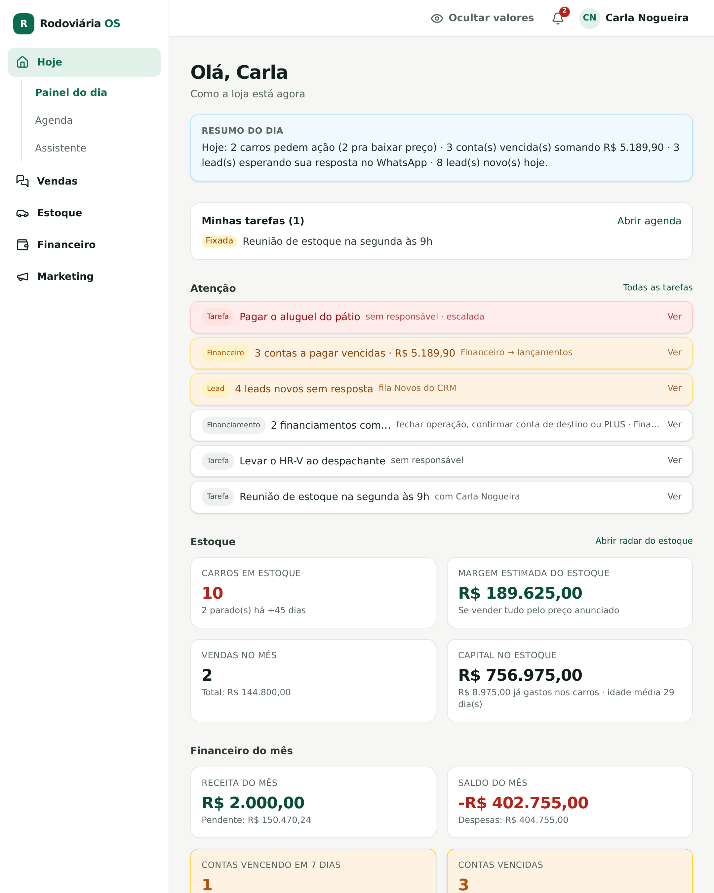
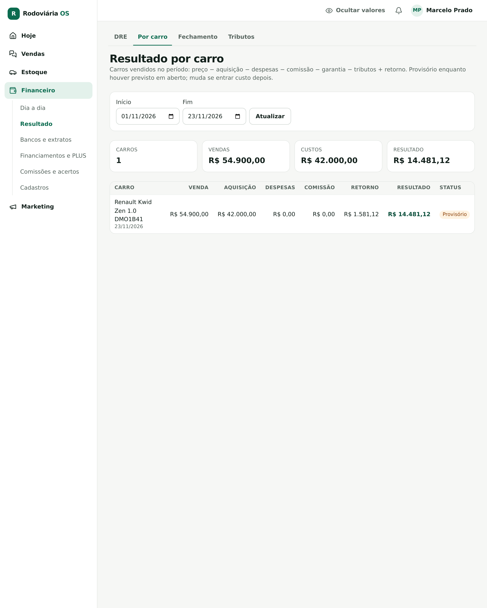
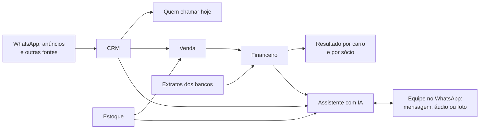

# RodoviariaOS

Sistema que eu criei para a Rodoviária Veículos, revenda de carros da minha família em Bauru/SP, onde eu trabalho com anúncios, leads e atendimento. Ele acompanha a loja inteira: do cliente que chama no WhatsApp até o resultado de cada carro vendido. Hoje roda na loja todos os dias.

O código é fechado: o sistema trabalha com dados reais da loja e quero transformá-lo em produto para outras revendas. Aqui eu conto o que ele faz e mostro algumas telas, todas com dados inventados de uma loja de demonstração.

  

O painel que a loja abre de manhã.

> **English summary.** RodoviariaOS is the system I built for my family's used car dealership in Bauru, Brazil, and it runs at the store every day. It started as a CRM connected to WhatsApp that tells salespeople who needs a follow-up and tracks each lead from the ad to the sale. Inventory, sales and a per-partner finance module that reads bank statements came next, and then an AI assistant the team talks to on WhatsApp by text, voice or photo. Built with TypeScript, Next.js, Fastify and PostgreSQL. The code is private; the screenshots use made-up demo data.

## Começou pelo CRM

O problema era o volume de leads. Chegam centenas, de todas as fontes, e o vendedor se perde no meio: não sabe quem está quente, quem esfriou, nem há quanto tempo está sem falar com cada um.

O CRM é ligado ao WhatsApp da loja. Quem manda mensagem vira lead na hora, sem cadastro repetido, e já cai para um vendedor. O sistema monta sozinho a fila de quem precisa ser chamado e de quem precisa de um novo contato, e a conversa aparece na tela em tempo real.

Cada lead guarda o próprio funil: de onde veio, há quanto tempo chegou e se está quente ou frio. Quando ele chega por um anúncio do Meta, fica ligado à campanha e ao carro anunciado. Com isso dá para acompanhar o caminho inteiro, do anúncio até a venda, medir de verdade o que o tráfego pago traz e enxergar onde a gente está perdendo cliente.

## O estoque e a venda

Cada carro tem um dossiê: custo, despesas, preparação, documentos, interessados, negociação e resultado. O sistema consulta a FIPE e a placa, e avisa quando entra um carro que combina com o que algum cliente está procurando.

A venda é registrada passo a passo: proposta, forma de pagamento (sinal, financiamento, troca), contrato e baixa dos recebimentos. Também cobre o que vem depois: distrato, pós-venda e garantia.

Para ajudar a comprar bem, um radar compara anúncios do mercado com carros parecidos e aponta as oportunidades.

## Depois veio o financeiro

Com o CRM funcionando, o próximo problema era o dinheiro. O sistema lê os extratos dos bancos, já cadastra fornecedores e clientes, sugere o que é cada lançamento e aprende as regras com o uso. Assim dá para ver onde estão as maiores despesas e se o mês deu lucro ou prejuízo.

Cada carro vendido mostra o próprio resultado: preço de venda menos aquisição, despesas, comissão, garantia e tributos. Como a loja tem mais de um sócio, cada um acompanha o próprio caixa, e o acerto das despesas comuns é feito sozinho.

  
  

Ele também ajuda nas questões tributárias, nas comissões e nas vendas, financiadas ou à vista.

## Cada pessoa vê só o que precisa

Dono, vendedor, marketing, contabilidade e administrador têm perfis diferentes. O vendedor nunca vê custo nem margem. Cada sócio vê custo e resultado só dos próprios carros; dos carros dos outros, vê apenas o catálogo.

## Por último, a IA

A IA veio para juntar tudo. Funciona como um secretário que sabe tudo da loja: ajuda a organizar, entender o estoque e ver os leads que precisam de atenção.

A equipe fala com ele pelo WhatsApp, por mensagem, áudio ou foto, sem abrir o sistema. Ele responde sobre estoque, leads e números, sempre com as permissões de quem pergunta, e pode mandar um resumo no começo do dia.

Ele não grava nada sozinho. Um lançamento só entra depois que a pessoa confirma por escrito; confirmação por áudio não vale, porque a transcrição pode errar. E o sistema funciona inteiro sem a IA.

## Marketing

Esta parte está pronta e espera a loja conectar as contas. Ela cria o anúncio no Meta a partir do carro e publica os carros nas redes sociais da loja.

## Como as partes se ligam

## Feito com

TypeScript · Next.js · Fastify · PostgreSQL

## Onde está hoje

Em uso na loja. Agora estou trabalhando no site da loja ligado ao estoque.

---

Vitor Brosque · [LinkedIn](https://www.linkedin.com/in/vitorbrosque) · [Portfólio](https://vitor-brosque.github.io)
