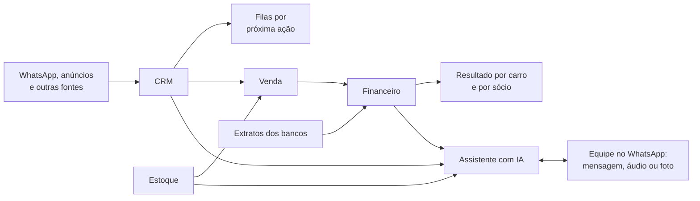

# RodoviariaOS

Sistema que eu criei para a Rodoviária Veículos, revenda de carros da minha família em Bauru/SP, onde eu trabalho com anúncios, leads e atendimento. Ele acompanha a loja inteira: do cliente que chama no WhatsApp até o resultado de cada carro vendido.

A loja usa o CRM todos os dias desde julho de 2026. As outras partes estão prontas e entrando na rotina; o detalhe está em [Onde está hoje](#onde-está-hoje).

O código é fechado: o sistema trabalha com dados reais da loja e quero transformá-lo em produto para outras revendas. Aqui eu conto o que ele faz e mostro algumas telas, todas com dados inventados de uma loja de demonstração.

  

O painel do dia.

> **English summary.** RodoviariaOS is the system I built for my family's used car dealership in Bauru, Brazil. It started as a CRM connected to WhatsApp, which the store has used every day since July 2026: each lead lands in a queue by next action and keeps its source from the ad to the sale. Inventory came next. Sales, a per-partner finance module that reads bank statements and an AI assistant are built and tested, and are being rolled out at the store. Partners only see their own numbers, and that separation is enforced in the database with PostgreSQL Row-Level Security. Built with TypeScript, Next.js, Fastify and PostgreSQL. The code is private; the screenshots use made-up demo data.

## Começou pelo CRM

O problema era o volume de leads. Chegam centenas, de todas as fontes, e o vendedor se perde no meio: não sabe quem está quente, quem esfriou, nem há quanto tempo está sem falar com cada um.

O CRM é ligado ao WhatsApp da loja. Quem manda mensagem vira lead na hora e cai para o vendedor que está com menos leads em aberto. Se a pessoa já está em atendimento, a conversa nova entra no mesmo lead, em vez de criar outro. Tudo aparece na tela em tempo real.

O vendedor não precisa decidir por onde começar. Cada lead fica em uma fila só, pela próxima ação:

1. **Responder:** o cliente falou por último.
2. **Primeiro contato:** a loja ainda não respondeu.
3. **Tentativas:** venceu o prazo de tentar de novo.
4. **Negociação:** tem proposta, simulação ou visita marcada.

A cada tentativa o sistema sugere uma mensagem pronta, mas nunca envia sozinho. E ninguém é arquivado só porque o tempo passou: o que conta é tentativa feita de verdade.

Quem marca se o lead está quente ou frio é o vendedor. A IA pode sugerir, mas precisa citar o trecho da conversa em que se baseou.

Todo lead tem origem, e sem ela não dá para abrir uma negociação. A origem segue do lead para a negociação e da negociação para a venda, e não muda depois. Quando o cliente chega por um anúncio do Meta, o lead já fica ligado ao anúncio e ao carro. Assim os relatórios mostram, por origem e por campanha, quantos leads viraram negociação e venda, e quanto custou cada um.

## O estoque e a venda

Cada carro tem um dossiê: custo, despesas, preparação, documentos, interessados, negociação e resultado. O sistema consulta a FIPE e a placa, e avisa quando entra um carro que combina com o que algum cliente está procurando.

A venda é registrada passo a passo: proposta, forma de pagamento (sinal, financiamento, troca), contrato e baixa dos recebimentos. O carro que entra numa troca vira estoque, com o valor da troca como custo. Se a venda é desfeita, o distrato fica registrado sem apagar o histórico.

Para ajudar a comprar bem, um radar compara cada anúncio do mercado com a mediana de carros parecidos (mesma versão, ano e faixa de quilometragem) e mostra a conta que fez. O que está bem abaixo vira "oportunidade". O que está barato demais vira "conferir", porque pode ser leilão, sinistro ou erro de digitação. E anúncio que sai do ar nunca é contado como vendido: seria inventar dado.

## Depois veio o financeiro

Com o CRM funcionando, o próximo problema era o dinheiro. O sistema lê os extratos dos bancos em vários formatos (OFX, CSV, planilha e PDF) e reconhece fornecedores e clientes nas linhas.

Extrato errado é pior do que extrato nenhum. Por isso, nos extratos em PDF, a leitura tem uma prova real: a soma dos lançamentos precisa bater, centavo a centavo, com o saldo que o banco imprimiu. Se não bate, o arquivo inteiro é recusado. O mesmo arquivo não entra duas vezes, e uma linha repetida aparece marcada, nunca some sem aviso.

Cada classificação confirmada ensina uma regra, que passa a sugerir a categoria nas próximas vezes. Na conciliação, o sistema mostra os lançamentos candidatos para cada linha do extrato e explica por que cada um combina, mas quem liga um ao outro é sempre uma pessoa.

Cada carro mostra o próprio resultado: preço de venda menos aquisição, despesas, comissão, garantia e tributos, mais as receitas ligadas à venda. O resultado fica marcado como provisório enquanto houver algo previsto em aberto, e só vira final quando tudo foi pago e recebido.

Como a loja tem mais de um sócio, cada um acompanha o próprio caixa, e o acerto das despesas comuns é feito sozinho.

  
  

## Cada pessoa vê só o que precisa

Sócio, vendedor, marketing, financeiro e administrador têm perfis diferentes. O vendedor não vê custo nem margem, e o marketing não vê receita. Cada sócio vê custo e resultado só dos próprios carros; dos carros dos outros, vê apenas o catálogo.

Essa separação não depende só da tela: ela é feita no banco de dados. Até ordenar a lista por margem considera só os carros que a pessoa pode ver por inteiro, para ninguém descobrir o custo do outro por dedução.

## Por último, a IA

A IA veio para juntar tudo. Funciona como um secretário que sabe tudo da loja: ajuda a organizar, entender o estoque e ver os leads que precisam de atenção.

A equipe fala com ele dentro do sistema ou pelo WhatsApp, por mensagem, áudio ou foto. Ele responde sobre estoque, leads e números, sempre com as permissões de quem pergunta, e pode mandar um resumo diário. No WhatsApp, só atende os números autorizados pela loja.

Ele foi feito para ler muito e agir pouco. A IA só entende o pedido; quem busca os dados e executa é o próprio sistema, pelo mesmo caminho das telas. As poucas ações que gravam alguma coisa, como lançar uma despesa ou criar uma tarefa, viram uma proposta que só vale depois de um "confirmo" por escrito. Confirmação por áudio não vale, porque a transcrição pode errar, e nada movimenta dinheiro.

O sistema funciona inteiro sem a IA, e cada loja define um teto mensal de gasto com ela.

## Marketing

Cria o anúncio no Meta a partir do carro e publica os carros nas redes sociais da loja.

## Como as partes se ligam

## Por dentro

Para quem é da área.

**Stack:** TypeScript · Next.js · React · Fastify · PostgreSQL · Drizzle · Zod · Vitest

**Isolamento no banco.** A separação entre lojas e entre sócios é feita com Row-Level Security do PostgreSQL. Toda consulta roda com o contexto da loja e do usuário, e sem contexto ela falha em vez de devolver dados. Esquecer um filtro no código não vaza nada. Um teste quebra se uma tabela nova nascer sem política, e outro percorre as rotas de leitura tentando ver os dados de outro sócio.

**WhatsApp sem perder nem duplicar mensagem.** Cada mensagem chega por webhook assinado e é gravada antes de ser processada, com chave única, então uma reentrega não duplica. O processamento roda em segundo plano, com limite de quantas ao mesmo tempo e novas tentativas se algo falhar.

**Sem Redis, sem fila externa e sem cron.** A fila e o cache ficam em tabelas do próprio PostgreSQL, e as tarefas agendadas são timers dentro da API. É uma escolha para manter a operação simples no tamanho atual; o preço é não escalar para várias instâncias sem mudar isso.

**IA como classificadora, não como agente.** Regras reconhecem a maioria dos comandos sem IA. Quando não reconhecem, o modelo recebe só a mensagem da pessoa e devolve uma intenção de uma lista fechada, validada antes de qualquer uso. No assistente, nenhum dado da loja vai para o modelo, e ele não decide permissão nem confirmação.

**Testes.** Cerca de 1.400 testes na API, rodando contra um PostgreSQL de verdade, e cerca de 150 no front. Cobrem isolamento entre lojas, acesso entre sócios e concorrência.

**Deploy em etapas.** Cada etapa só começa se a anterior passou: testes, backup do banco, migrations numa transação, build fora da pasta em produção e troca com rollback automático.

**Um problema que ensinou bastante.** Em setembro de 2026, todas as conexões com o banco ficaram presas e o login parou de responder. A causa era um trecho que, dentro de uma transação, pedia uma segunda conexão ao mesmo pool; uma rajada de mensagens do WhatsApp fez todas esperarem por uma conexão que nunca vinha. O problema foi reproduzido em teste antes da correção. Hoje a transação é passada adiante em vez de abrir outra, há limite de mensagens processadas ao mesmo tempo, e o sistema devolve erro em vez de travar.

## Onde está hoje

- **Em uso na loja:** o CRM com WhatsApp, desde julho de 2026, e o estoque, desde outubro.
- **Pronto e testado, entrando na rotina:** vendas, financeiro e assistente.
- **Pronto, esperando a loja conectar as contas:** marketing.
- **Em andamento:** o site da loja ligado ao estoque e o radar de compra, em teste.

---

Vitor Brosque · [LinkedIn](https://www.linkedin.com/in/vitorbrosque) · [Portfólio](https://vitor-brosque.github.io)
