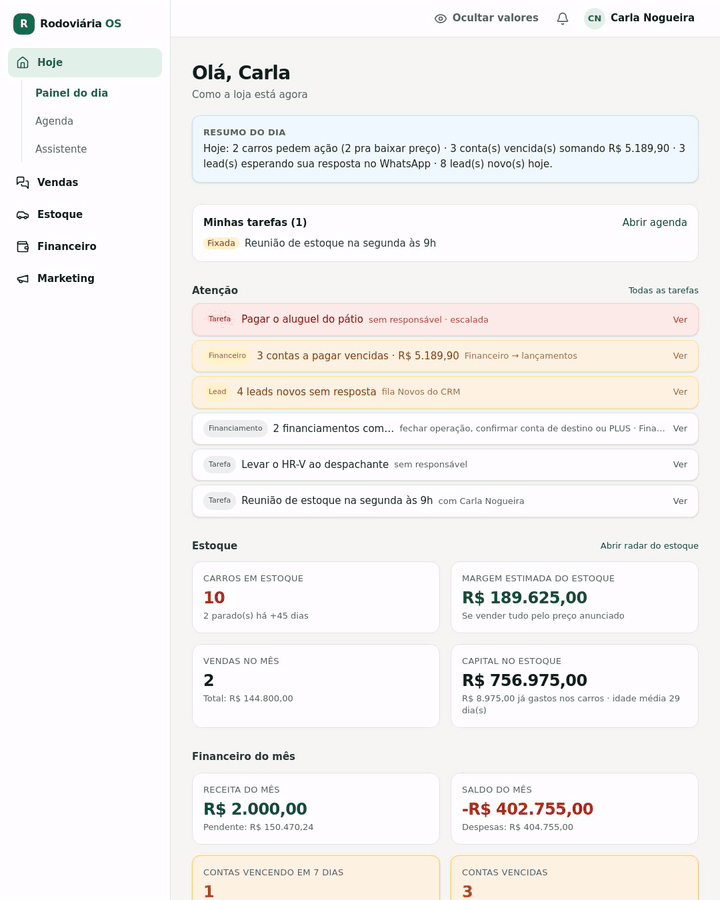
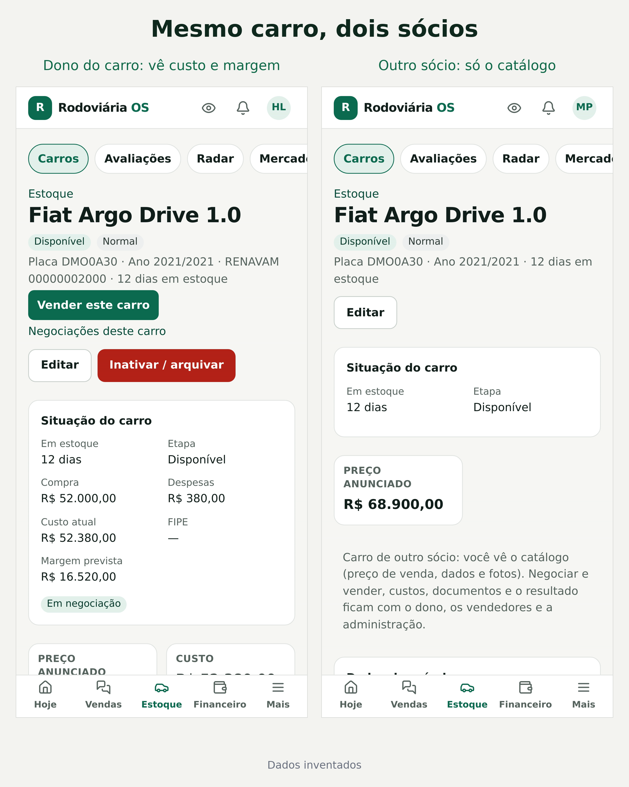
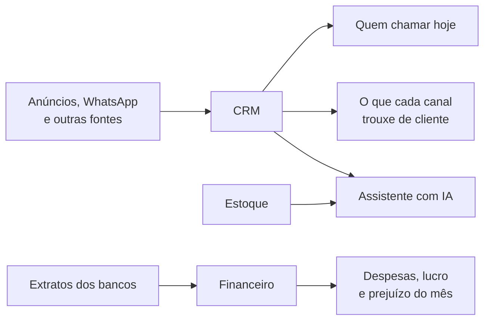

# RodoviariaOS

Sistema que eu criei para a Rodoviária Veículos, revenda de carros da minha família em Bauru/SP, onde eu trabalho com anúncios, leads e atendimento. Hoje ele roda na loja todos os dias.

O código é fechado: o sistema trabalha com dados reais da loja e quero transformá-lo em produto para outras revendas. Aqui eu conto o que ele faz e mostro as telas.

  
  

O painel que a loja abre de manhã e o botão que esconde todos os valores da tela. Todas as imagens usam dados inventados de uma loja de demonstração.

> **English summary.** RodoviariaOS is the system I built for my family's used car dealership in Bauru, Brazil, and it runs at the store every day. It started as a CRM that tells salespeople who needs a follow-up and records where each lead came from. A finance module that reads bank statements came next, and then an AI assistant that knows the store's inventory and leads. Built with TypeScript, Next.js, Fastify and PostgreSQL. The code is private; the screenshots use made-up demo data.

## Começou pelo CRM

O problema era o volume de leads. Chegam centenas, de todas as fontes, e o vendedor se perde no meio: não sabe quem está quente, quem esfriou, nem há quanto tempo está sem falar com cada um.

O CRM resolve isso montando sozinho a lista de quem precisa ser chamado. Ele também registra o funil de cada lead: de onde veio, há quanto tempo chegou e se está quente ou frio. Com isso dá para medir de verdade o que o tráfego pago traz e enxergar onde a gente está perdendo cliente.

Quando o lead vira negócio, a venda é registrada passo a passo: o carro, como o cliente vai pagar, a proposta e o fechamento.

https://github.com/user-attachments/assets/f86f5191-5bda-458b-bf8d-fa4ae405edc1

## Depois veio o financeiro

Com o CRM funcionando, o próximo problema era o dinheiro. O sistema lê os extratos dos bancos, já cadastra fornecedores e clientes e identifica o que é cada lançamento. Assim dá para ver onde estão as maiores despesas e se o mês deu lucro ou prejuízo.

Cada carro vendido mostra o próprio resultado: preço de venda menos aquisição, despesas, comissão, garantia e tributos. E como a loja tem mais de um sócio, cada um vê custo e margem só dos próprios carros; dos outros, vê apenas o catálogo.

  
  

Ele também ajuda nas questões tributárias e nas vendas, financiadas ou à vista.

## Por último, a IA

A IA veio para juntar tudo. Funciona como um secretário que sabe tudo da loja: ajuda a organizar, entender o estoque e ver os leads que precisam de atenção.

O assistente responde só com o que o usuário pode ver, e um lançamento só é gravado depois que a pessoa confirma.

https://github.com/user-attachments/assets/62e7a452-e5ea-4834-b083-531190ff87bf

## Como as partes se ligam

## Feito com

TypeScript · Next.js · Fastify · PostgreSQL

## Onde está hoje

Em uso na loja. Agora estou trabalhando na simulação de financiamento nos bancos e no site da loja ligado ao estoque.

---

Vitor Brosque · [LinkedIn](https://www.linkedin.com/in/vitorbrosque) · [Portfólio](https://vitor-brosque.github.io)
